

  

<h1 align="center">Glass Power Tools</h1>

  <strong>Terminals, databases, remote desktops and an editor for every machine you work on.</strong> 
  One app, built natively for Apple Vision Pro, Mac, iPad and iPhone.

  <a href="https://github.com/msitarzewski/GlassPowerTools/releases/latest">Download for Mac</a> ·
  <a href="https://glasspowertools.com">Website</a> ·
  <a href="https://glasspowertools.com/help/">Help</a> ·
  <a href="https://glasspowertools.com/why.html">Why one app</a> ·
  <a href="SECURITY.md">Security</a> ·
  <a href="https://github.com/sponsors/msitarzewski">Sponsor</a>

  
  
  
  

  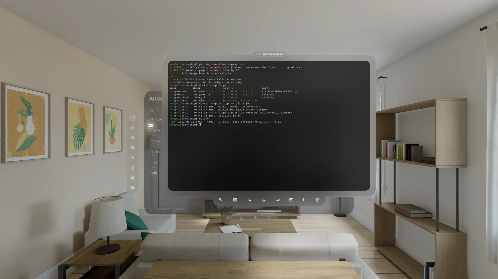
   A terminal on Apple Vision Pro, running btop, with the room behind its glass. Every machine in these pictures is made up.

## Vision Pro first

It started as an SSH client for Apple Vision Pro, and the headset still leads the design. Each
session is a normal window you place around you, so a server's terminal, its database and its
desktop can sit side by side in the room. A window you aren't using can shrink into a small glass
orb, with its session live inside it, until you pinch it back.

Every window is glass. **Opacity** sets how much of the theme's colour is painted, **Glass** how
much the room is frosted behind it; the pictures here use 78% and 50%.

<table>
  <tr>
    <td width="33%">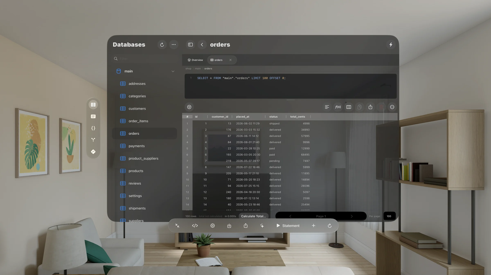</td>
    <td width="33%">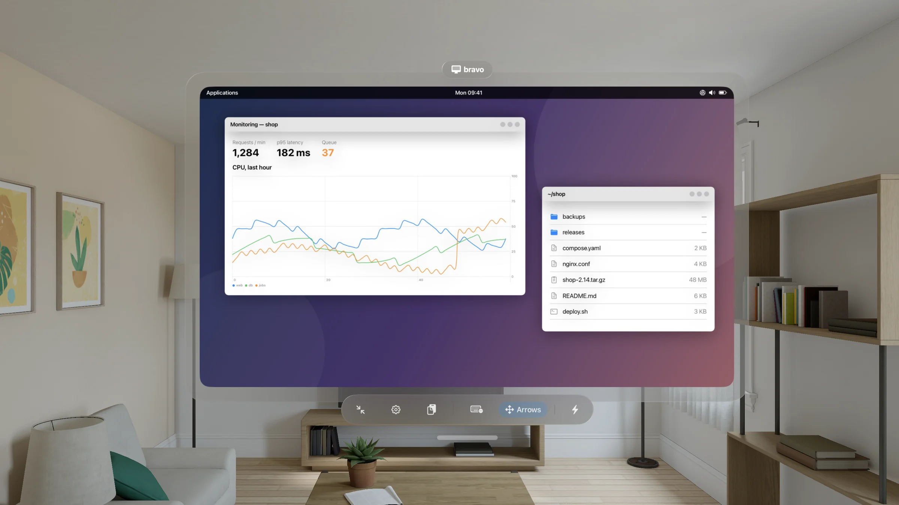</td>
    <td width="33%">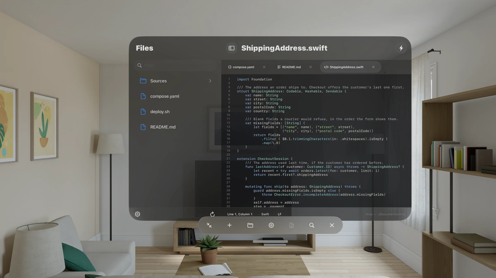</td>
  </tr>
  <tr>
    <td><strong>Databases.</strong> The shop's orders: the query above, the rows below.</td>
    <td><strong>Remote desktops.</strong> A machine's own screen, as large as you make the window.</td>
    <td><strong>Editor.</strong> A project's files, and the one you're changing.</td>
  </tr>
</table>

## Pick up where you left off

Turn on **Keep Sessions Running with tmux** for a machine, and each terminal you open there runs in
its own tmux session on that machine. A dropped connection, a closed window or a quit app leaves the
work running.

<table>
  <tr>
    <td width="50%">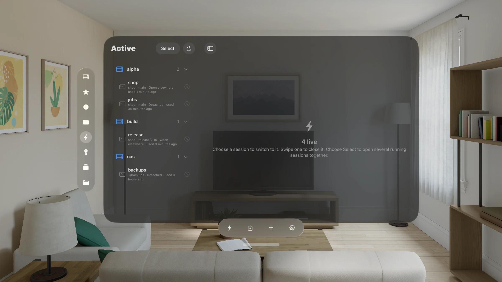</td>
    <td width="50%">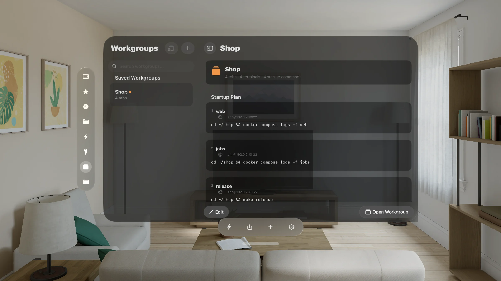</td>
  </tr>
  <tr>
    <td><strong>Move a session between devices.</strong> Active lists what runs in tmux on each machine. Join one here, or take it over: start a build on the Mac and watch it from the headset.</td>
    <td><strong>Workgroups that come back.</strong> After a quit, a crash or an update, the windows return on the same sessions, with everything still running.</td>
  </tr>
</table>

## On the Mac

The same app, with a local shell, menus and windows that are as see-through as you like.

<table>
  <tr>
    <td width="50%">
      <picture>
        <source media="(prefers-color-scheme: dark)" srcset="site/static/shots/mac-terminal-dark.webp">
        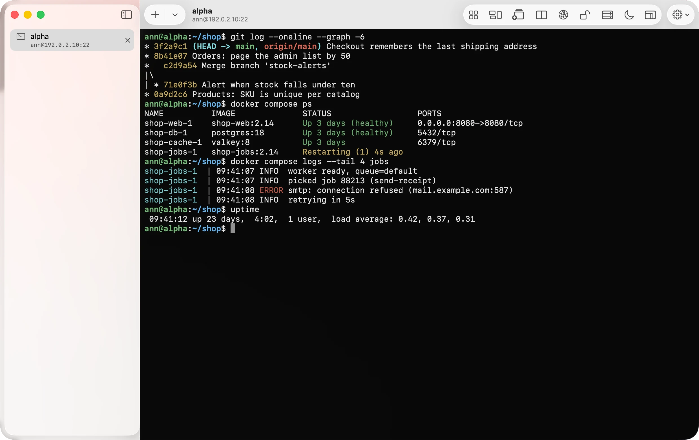
      </picture>
    </td>
    <td width="50%">
      <picture>
        <source media="(prefers-color-scheme: dark)" srcset="site/static/shots/mac-database-dark.webp">
        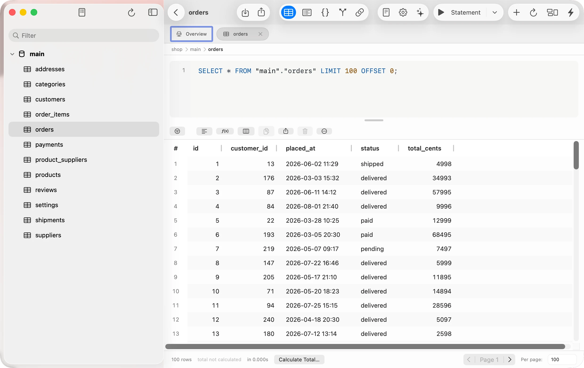
      </picture>
    </td>
  </tr>
  <tr>
    <td><strong>Terminal.</strong> SSH with host keys you confirm, tabs in a sidebar, tmux sessions you pick up on any device, and the server's files a click away.</td>
    <td><strong>Databases.</strong> MySQL, PostgreSQL and SQLite: browse, filter and edit rows, follow foreign keys, write and explain queries.</td>
  </tr>
  <tr>
    <td>
      <picture>
        <source media="(prefers-color-scheme: dark)" srcset="site/static/shots/mac-desktop-dark.webp">
        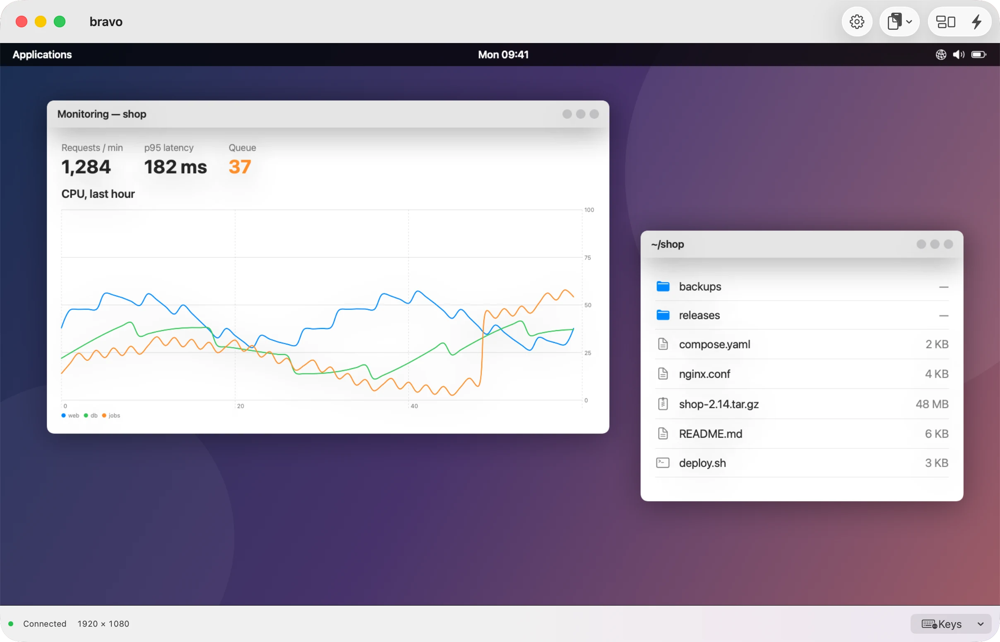
      </picture>
    </td>
    <td>
      <picture>
        <source media="(prefers-color-scheme: dark)" srcset="site/static/shots/mac-editor-dark.webp">
        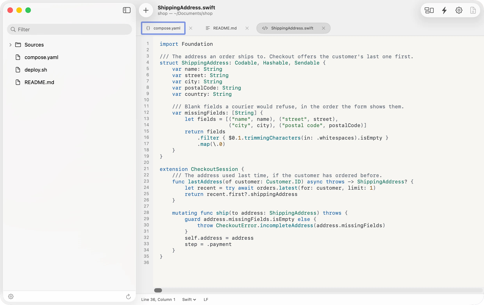
      </picture>
    </td>
  </tr>
  <tr>
    <td><strong>Remote desktops.</strong> RDP and VNC, with the remote resolution following your window.</td>
    <td><strong>Editor.</strong> Files on this device or on a server, with highlighting, previews, and viewers for pictures, PDFs and 3D models.</td>
  </tr>
</table>

## A terminal worth looking at

You look at terminals all day, so each window can have a look of its own: a picture behind the text,
Digital Rain that falls faster while the terminal prints, a Synthwave horizon, an aurora, a starfield
that streaks into warp while output pours, a blueprint, green or amber phosphor, a glow. The Coding
Agent look shows the agent each terminal runs, Claude Code, Codex or another, in its own colour:
drifting while it works, still and glowing when it's waiting for you. The text comes first: a picture's bright patches are held down so even dim text
reads over them, and the motion stops under Reduce Motion and Low Power Mode. On the Mac, iPad and
Vision Pro, in a window's **This Window** settings.

<table>
  <tr>
    <td width="50%">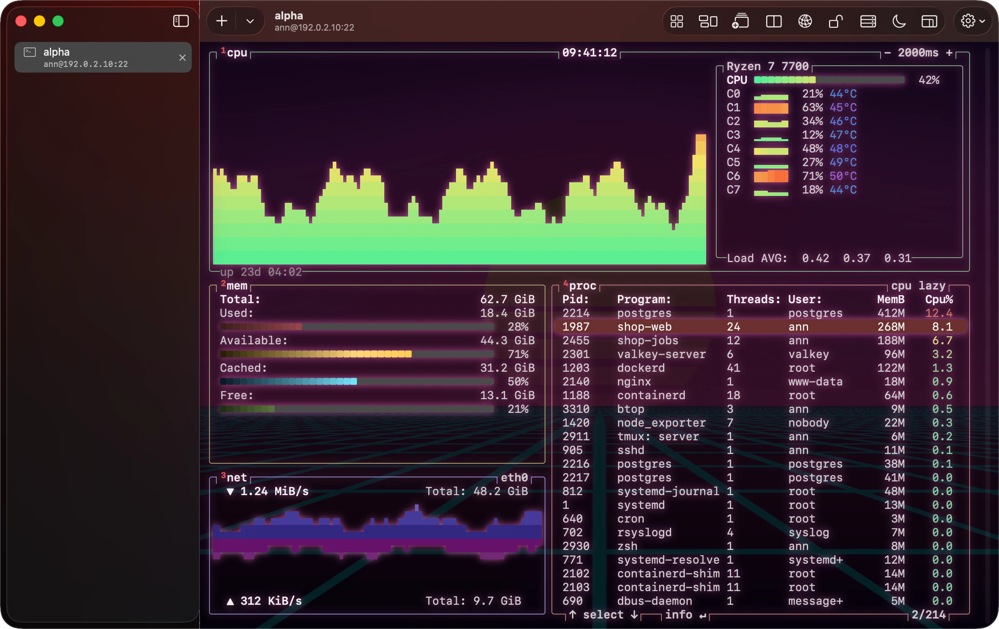</td>
    <td width="50%">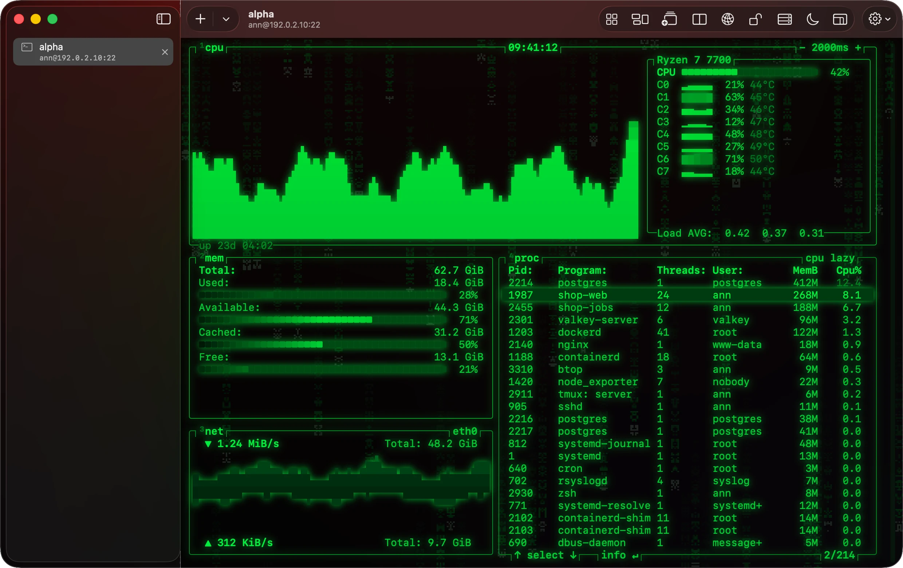</td>
  </tr>
  <tr>
    <td><strong>Synthwave.</strong> A sun going down behind the process list.</td>
    <td><strong>Digital Rain.</strong> It falls faster while the terminal prints.</td>
  </tr>
  <tr>
    <td>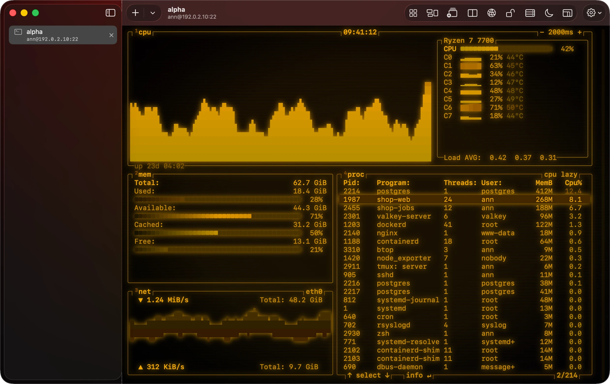</td>
    <td>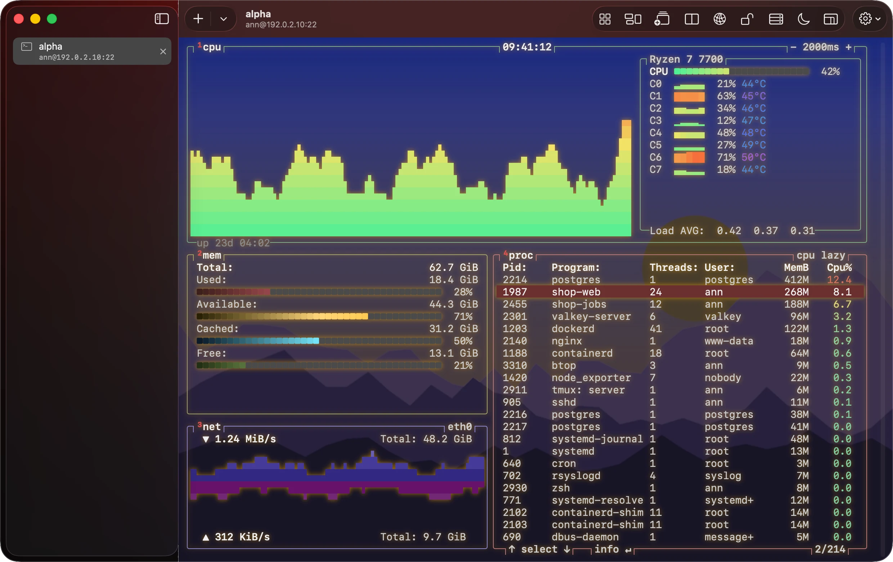</td>
  </tr>
  <tr>
    <td><strong>Amber Phosphor.</strong> Every colour a program draws, in amber, 24-bit colour included.</td>
    <td><strong>A picture of yours.</strong> Blurred, pixelated or toned to the theme if you like, with a glow on the text.</td>
  </tr>
  <tr>
    <td>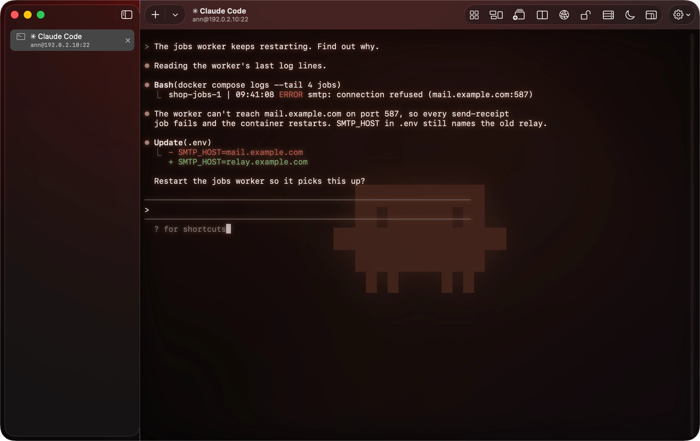</td>
    <td>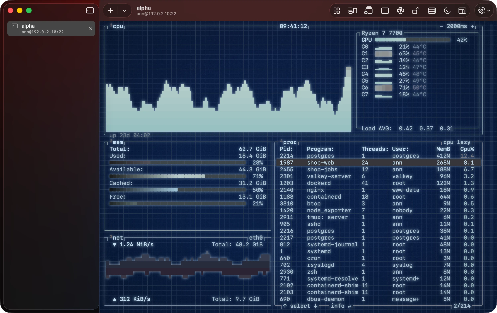</td>
  </tr>
  <tr>
    <td><strong>Coding Agent.</strong> The agent each terminal runs, in its colour: drifting while it works, still and glowing when it waits for you.</td>
    <td><strong>Blueprint.</strong> A drafting grid, with every colour in pale blue.</td>
  </tr>
</table>

## iPad and iPhone

The same library and the same machines. The iPhone gives each session the whole screen.

  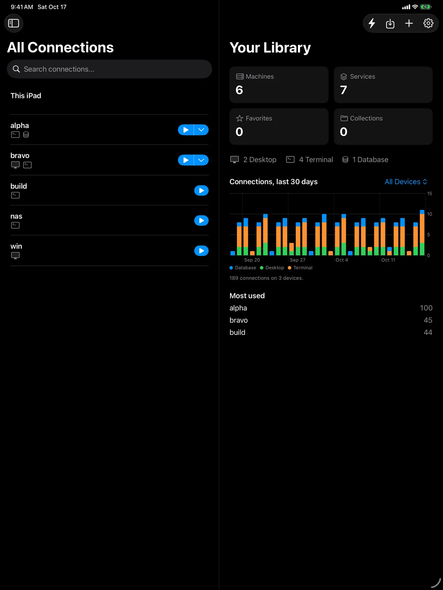
  &nbsp;&nbsp;
  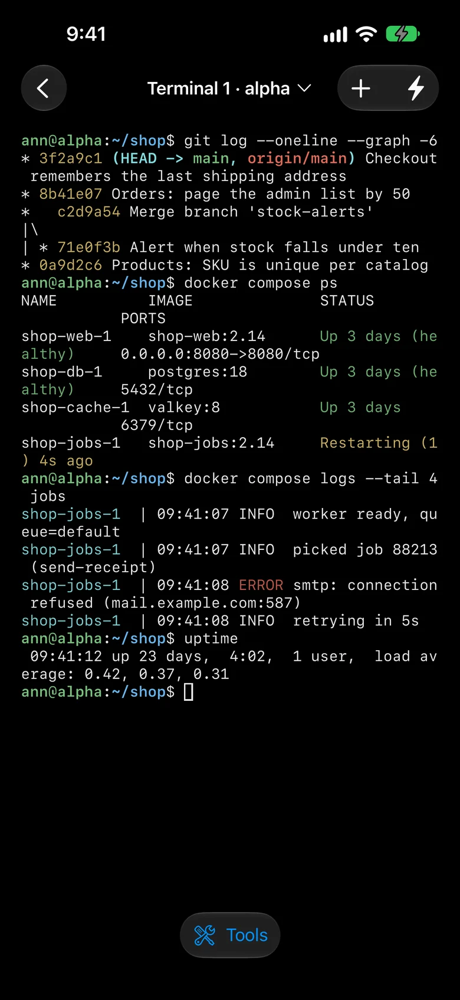

## Why one app

A machine you work on often has several ways in: a shell, a database, a desktop, files to edit. Each
has its own protocol, and each protocol grew its own kind of app. So a common setup is one app per
protocol, each with its own list of the same machines, its own settings and its own idea of where you
are. When a machine's address changes, you change it in each app.

Glass Power Tools starts from the machine instead:

- **The address lives on the host.** You enter it once. Its Terminal, Database and Desktop services
  all use it. Change it, and every service follows.
- **Services list the ways in.** With one service, Connect opens it. With several, a split button
  opens all of them, or the one you choose.
- **Trust is set up once.** When you trust a machine's SSH host key, anything else that reaches it
  over SSH uses that trust. A database tunnel does not ask again.
- **One place for sessions.** Active lists every open terminal, database, desktop and editor window,
  grouped by machine, on every device.

<picture>
  <source media="(prefers-color-scheme: dark)" srcset="site/static/shots/mac-library-dark.webp">
  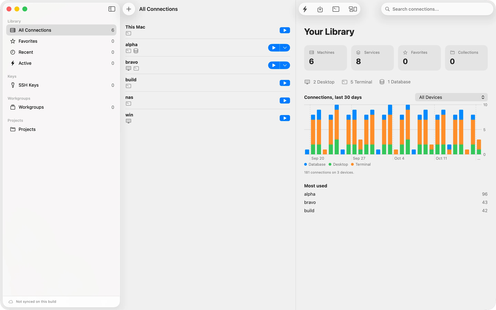
</picture>

**What it is not.** Not a service: no server of ours sits between you and your machines. Not on every
platform: Apple Vision Pro, Mac, iPad and iPhone only. Not certified: the RDP engine is an
independent implementation, tested against Windows 11, GNOME Remote Desktop and xrdp. And not needed
by everyone: if you reach one machine one way, a single-purpose app may serve you just as well. The
whole argument is on [the Why page](https://glasspowertools.com/why.html).

## What it does

- **Terminal:** SSH with host-key pinning, password and key sign-in (including keys held in the
  Secure Enclave), tabs, splits, themes, workgroups, port forwarding, and an SFTP file browser. A
  local shell on the Mac. Terminals kept in tmux, on servers and on the Mac, outlive the app and can
  be picked up on another device, and with tmux 3.2 or later the terminal keeps every line itself, so
  you scroll and select through the whole history. Windows scale as well as resize, and each can have
  a look of its own. On the Mac, a file whose path a terminal prints previews over it, SQL it prints
  opens in the query editor on that machine's database, and the folder button opens the shell's
  folder in the Finder, Files or the Editor.
- **Databases:** MySQL, PostgreSQL and SQLite — browse, filter and edit rows, follow foreign keys,
  see a live diagram of every table and key (in three dimensions on Vision Pro), write and explain
  queries (or ask the on-device assistant for one), reach a database directly with TLS, through its
  machine's SSH connection or through another machine, or mark it read-only.
- **Remote desktops:** RDP and VNC, including Apple's own Screen Sharing protocol (encrypted after
  you sign in with a Mac account), with the remote resolution following the window, a window per
  remote display, image quality that adapts to the link, audio, a shared clipboard with formatting
  and images, and see-through glass on Mac and Vision Pro.
- **Editor:** files on this device or on a server, projects with a file tree, syntax highlighting
  for fifteen languages, and previews for Markdown (with Mermaid diagrams), HTML, SVG and CSV;
  images, PDFs, video, audio and 3D models open as themselves. On the Mac it can be your default
  text editor.
- **Everywhere you are:** the library, favorites, workgroups and projects sync through iCloud, and
  credentials through iCloud Keychain; keys made in the Secure Enclave stay on their device. Your
  Library shows the time you spend on each machine, added up across your devices, and a Mac knows its
  own record in the library, so its Terminal opens a local shell rather than SSH to itself. Active
  and Show All Windows show what is open and running on every device; widgets, Siri and Shortcuts,
  Spotlight, Controls and Handoff reach your machines, and on the Mac so do the Finder's Services,
  toolbar button and Quick Action.

## How to use it

The [help](https://glasspowertools.com/help/) is written from the app's own code, for each device:

- **The library:** [browse](https://glasspowertools.com/help/library-browse.html),
  [add a machine](https://glasspowertools.com/help/library-add-host.html),
  [connect](https://glasspowertools.com/help/library-connect.html),
  [sync](https://glasspowertools.com/help/library-sync.html)
- **Terminal:** [connect](https://glasspowertools.com/help/terminal-connect.html),
  [keys and trust](https://glasspowertools.com/help/terminal-keys-and-trust.html),
  [tmux](https://glasspowertools.com/help/terminal-tmux.html),
  [workgroups](https://glasspowertools.com/help/terminal-workgroups.html),
  [looks](https://glasspowertools.com/help/terminal-looks.html)
- **Databases:** [add one](https://glasspowertools.com/help/database-add-service.html),
  [the workspace](https://glasspowertools.com/help/database-workspace.html),
  [the schema diagram](https://glasspowertools.com/help/database-schema-diagram.html)
- **Remote desktops:** [add one](https://glasspowertools.com/help/desktop-add-service.html),
  [on Vision Pro](https://glasspowertools.com/help/desktop-vision-pro.html)
- **Editor:** [opening files](https://glasspowertools.com/help/editor-opening.html),
  [projects](https://glasspowertools.com/help/editor-projects.html),
  [previews and viewers](https://glasspowertools.com/help/editor-preview-and-viewers.html)

## How it's made

Glass Power Tools is built by [Michael Sitarzewski](https://msitarzewski.com) with AI coding agents,
working from a written memory bank instead of from memory. Every decision is recorded with its
reason in [`memory-bank/decisions.md`](memory-bank/decisions.md); what has been checked on real
devices and servers, and what has not, is in [`memory-bank/progress.md`](memory-bank/progress.md);
and [`AGENTS.md`](AGENTS.md) is the guide that anyone, person or agent, follows to change it. The
claims on the website were checked against the code and its test records.

## Status

The Mac app is at 0.4.494 (its first release was 0.4.491): download it from
[glasspowertools.com](https://glasspowertools.com) or this repository's
[releases](https://github.com/msitarzewski/GlassPowerTools/releases). It is signed with a Developer ID,
notarized by Apple, and updates itself through Sparkle. It cannot be in the Mac App Store, because a
terminal cannot work inside App Sandbox. The iPhone, iPad and Vision Pro apps are in TestFlight for
internal testing, and come to the App Store as 1.0. What each build holds is in
[RELEASE-NOTES.md](RELEASE-NOTES.md).

## Build it

You need a Mac with Apple silicon and Xcode 27. See
[Documentation/BUILDING.md](Documentation/BUILDING.md), including how to sign it under your own
Apple Developer team.

## Security and privacy

The app talks to the servers you add and to iCloud, and to nothing else unless you connect a
Tailscale account for device discovery, or open a link to a 3D model that a terminal printed; the
Mac app also checks its update feed. There are no analytics. Secrets live in the Keychain. See
[SECURITY.md](SECURITY.md) for how credentials and connections are protected — and what is not
protected — and how to report a vulnerability.

## Support it

Glass Power Tools is free and has no ads, accounts or subscriptions. If it earns a place in your day,
[sponsor it on GitHub](https://github.com/sponsors/msitarzewski).

## Contributing

See [CONTRIBUTING.md](CONTRIBUTING.md). Before your first pull request is merged, agree to the
[Contributor License Agreement](CLA.md) by putting its sentence in the pull request.

## More from Michael

- **[Agency Agents](https://github.com/msitarzewski/agency-agents):** a complete AI agency at your
  fingertips. Specialized agent personas, each with its own process and deliverables, and a
  [native installer](https://agencyagents.app) that puts them into Claude Code, Codex, Cursor, Gemini
  CLI and more.
- **[msitarzewski.com](https://msitarzewski.com):** builder, entrepreneur and creator, and what he's
  working on.

## Licence

Copyright © 2026 Michael Sitarzewski. Glass Power Tools is free software: you can redistribute it
and/or modify it under the terms of the GNU General Public License, version 3, as published by the
Free Software Foundation ([LICENSE](LICENSE)). It comes with no warranty. Contributions come with the
permissions in [CLA.md](CLA.md). Third-party components keep their own licences; see
[THIRD-PARTY-NOTICES.md](THIRD-PARTY-NOTICES.md), and Settings ▸ About ▸ Acknowledgements in the app.
